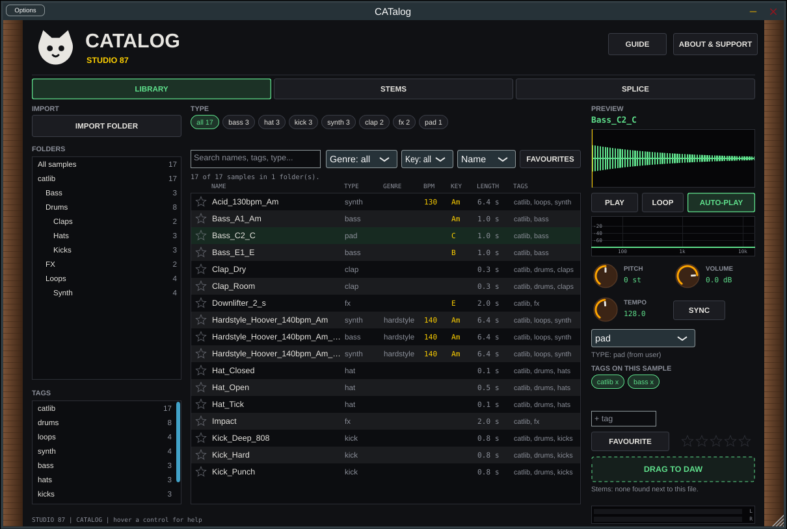

# CATalog 🐈

Sample manager for your studio (standalone and VST3): scan your sample folders, search, tag, rate, favourite, and listen.

**Manual:** [PDF, opens in the browser](https://github.com/SpeakingColors/CATalog/blob/main/docs/CATalog-manual.pdf)

 Screenshot of the real plugin window (Linux standalone build) with a small test library.

## Status
Early. What exists today:
- A tested pure C++ library model (`src/core`): import as many folders as you like (every subfolder at any depth is read), formats wav, aiff, flac, ogg, mp3, m4a, aac, opus and more (what plays depends on the decoders in your OS and JUCE), BPM and key from file names and from the audio itself (`Analysis.h`: onset curve for tempo, chroma profile for key, plain wav read directly; other formats are decoded by the app), type (kick, snare, hat, bass, synth, stab, pad, lead, vocal, fx, loop...) from file and folder words first and from the sound when the name says nothing, genre only from words in names, stem files found next to a loop (`Loop_drums`, `Loop_bass`, a `Loop stems` folder), watch-folder rescan, natural sort, search by words, tags, folder, type, genre, key, favourites, rating, BPM range, and your tags / favourites / ratings / type fixes kept in a plain text file that survives rescans. These are estimates, not certainties.
- A JUCE app and plugin shell (`src/catalog`) with a real cat-ui window (wood cheeks, resizable at a fixed aspect, three tabs). Library: folder tree, tag list, type chips, search with genre, key and sort filters, the sample table with favourite stars, and a preview panel with waveform, spectrum, play, loop, auto-play, pitch, volume, tempo sync, level meter, type fix, tag chips, star rating and drag to the DAW. Stems: the stem files found next to the selected loop, click a card to play it (CATalog does not split audio into stems). Splice: choose the folder Splice saves into, CATalog watches it and lists what it imported (no Splice login: Splice has no public API for other apps).
- Pitch and tempo sync work like tape: speed and pitch move together (no separate time stretch here; Stretch Cat does that). The sync tempo follows the host tempo when used as a plugin until you turn the knob.
- Not built: send to SupurrSaw (needs the shared single-cycle wave library on the SupurrSaw side), saved searches (the preset bar in the mockup), the Settings button, Add files. Nothing here has been tried by ear, in a real DAW, or with a real sample library yet (the spectrum, level, pitch and sync were drawn and compiled but not heard: this build machine has no audio device); the m4a and aac paths depend on the OS decoder.

Run the model tests: `sh tests/run.sh` (needs only g++).

  

☕ Free and open source, made by one person. If it helps your music, a coffee on [Ko-fi](https://ko-fi.com/studio87) keeps it coming. 💜

## Docs
- [Interactive mockups](docs/README.md)
- [Roadmap](ROADMAP.md)

## License
AGPL-3.0-or-later, see [LICENSE](LICENSE).

Not affiliated with or endorsed by any hardware maker named here. All trademarks belong to their owners.
